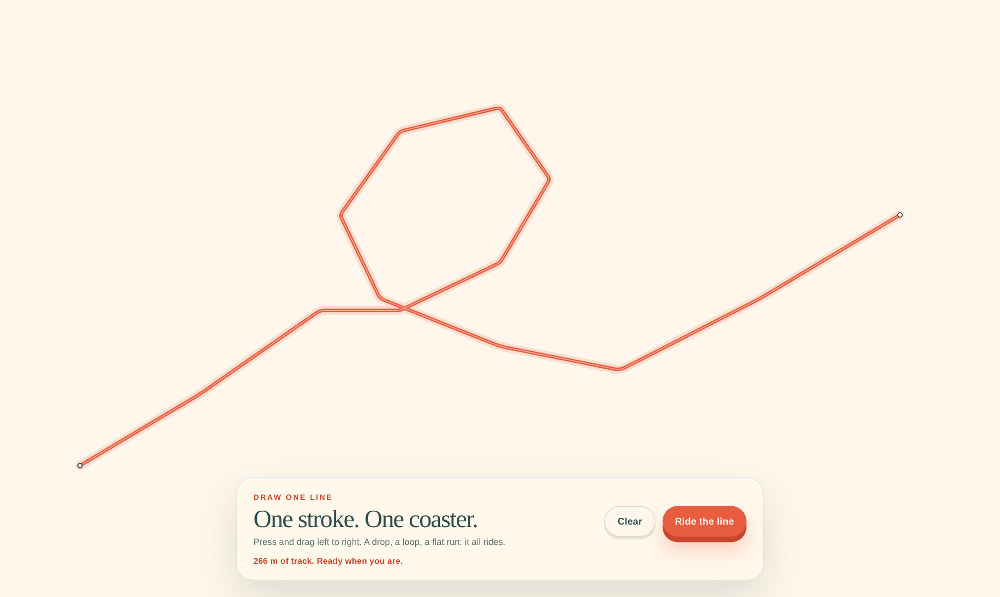

# Papercoaster

[](https://github.com/jimmerioles/papercoaster/actions/workflows/ci.yml)
[](https://github.com/jimmerioles/papercoaster/actions/workflows/deploy.yml)
[](https://jimmerioles.github.io/papercoaster/)
[](LICENSE)

Draw a line. Ride it.

A three.js side project: turn a single stroke into a rollercoaster through a paper diorama, then ride it in first person.

**Status:** the drawing layer is landed on top of the v0.1.0 feel test. Draw a line, then ride it.

**Live demo:** https://jimmerioles.github.io/papercoaster/





## Run

Requires Node 22.12 or newer.

```bash
npm install
npm run dev
```

Open http://localhost:5173.

## Controls

- Click "Draw a line", then press and drag one stroke. The stroke becomes the track.
- Clear removes the stroke. Ride the line builds the track and starts the ride.
- `C` toggles comfort view (horizon lock and fixed FOV). It turns on by default when the system prefers reduced motion.
- `R` restarts the ride while riding or from the end screen.
- Add `?t=0.18` for the drop, `?t=0.48` for the loop, or `?t=0.66` for the turn to freeze the test track. The UI is hidden in these views. A reload cannot rebuild a drawn stroke, so `?t` on load uses the test track.

## What is in it

- One-stroke drawing on a pointer or touch screen, with Clear and Redraw.
- A stroke pipeline: dedupe, Chaikin smoothing, even resampling, and rejection of short, jumpy, or off-canvas lines.
- A drawn track with a drop, a loop, or a flat run, plus the same POV camera, speed model, and comfort view as the test track.
- A paper world: layered mountain rings, a winding river, a paper forest, clouds, a sun, and a start flag that moves with the start band.
- A speed HUD, progress bar, sound toggle, and procedural wind.
- A test track behind `?t=` for freeze views, and `createTestTrack()` for the idle scene and tests.
- Unit tests for the stroke pipeline and the track frame/dispose contract, plus a Playwright smoke test for the draw flow, freezes, and full ride restart.
- Debug frames: [loop](shots/loop.jpg), [banked turn](shots/turn.jpg).

## Development

```bash
npm run verify
npx playwright install chromium
npm run test
```

`npm run verify` runs the format check, lint, unit tests, and build. `npm run test` runs the Playwright smoke test. `npm run test:unit` runs the pure stroke tests with `node --test`. `npm run test:ui` opens the interactive runner. The Chromium install is once per machine. `npm run format` rewrites the files with Prettier. The production build uses the `/papercoaster/` base for GitHub Pages.

## Deploy

Pushes to `main` run CI and deploy `dist/` to GitHub Pages through `.github/workflows/deploy.yml`. The live URL is https://jimmerioles.github.io/papercoaster/.

## Handoff

- **Agents:** read [`AGENTS.md`](AGENTS.md) first. It has the run, verify, feel rules, and architecture map.
- **Design:** [`docs/design.md`](docs/design.md) has the camera, track, stroke, world, and drawing-layer notes.
- **Next:** [`docs/next.md`](docs/next.md) has what landed and the next milestones.
- **Tests:** [`tests/smoke.spec.js`](tests/smoke.spec.js) is the browser smoke test, and [`test/stroke.test.js`](test/stroke.test.js) covers the stroke pipeline.
- **Release:** [`docs/releases/v0.1.0.md`](docs/releases/v0.1.0.md) is the feel-test release note.

## Known rough edges

- A reload does not reconstruct a drawn stroke. Sharing is the next milestone.
- Background tabs throttle the ride.
- A side-view track has no banked turns. A depth input can add them later.
- The Playwright smoke test covers the draw flow and the freeze views. The visual composition still needs manual QA.

## Tech

- three.js 0.187
- Vite 8
- Playwright for the browser smoke test
- Plain JavaScript, no framework
- No external assets. Textures and geometry are generated in code.

## License

MIT.
