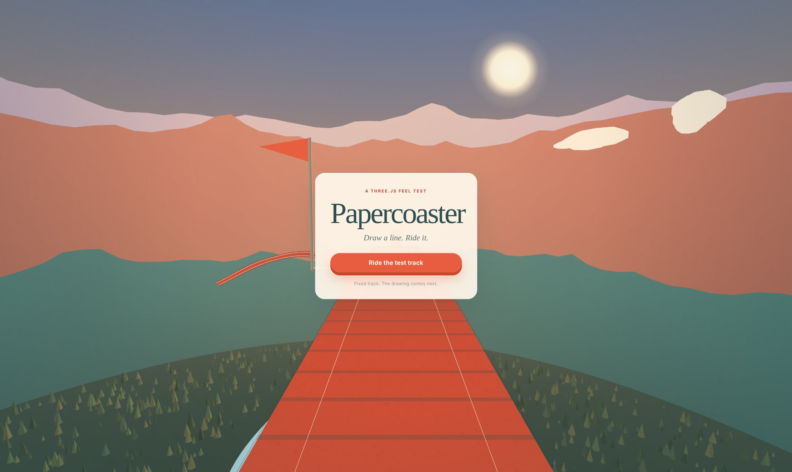
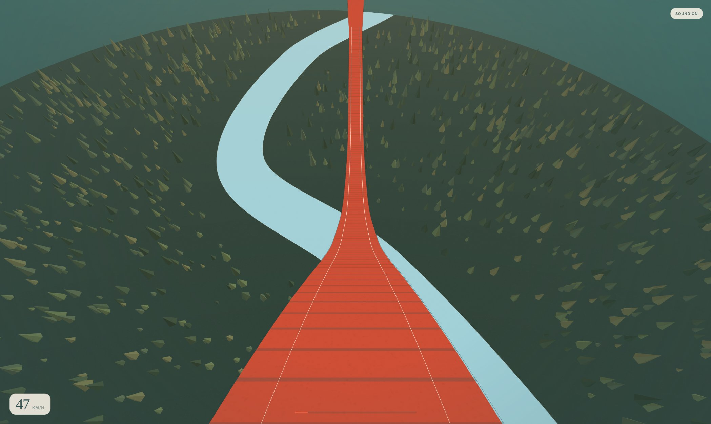

# Papercoaster

[](https://github.com/jimmerioles/papercoaster/actions/workflows/ci.yml)
[](https://github.com/jimmerioles/papercoaster/actions/workflows/deploy.yml)
[](https://jimmerioles.github.io/papercoaster/)
[](LICENSE)

Draw a line. Ride it.

A three.js side project: turn a single stroke into a rollercoaster through a paper diorama, then ride it in first person.

**Status:** v0.1.0 feel test. The track is fixed. The drawing layer is next.

**Live demo:** https://jimmerioles.github.io/papercoaster/





## Run

Requires Node 22.12 or newer.

```bash
npm install
npm run dev
```

Open http://localhost:5173.

## Controls

- Click "Ride the test track" to start.
- `C` toggles comfort view (horizon lock and fixed FOV). It turns on by default when the system prefers reduced motion.
- `R` restarts the ride.
- Add `?t=0.18` for the drop, `?t=0.48` for the loop, or `?t=0.66` for the turn to freeze the camera. The UI is hidden in these views.

## What is in the test

- A fixed track with a drop, a vertical loop, and a banked turn.
- A POV camera with speed-based FOV, look-ahead, and banking.
- A paper world: layered mountain rings, a winding river, a paper forest, clouds, a sun, and a start flag.
- A speed HUD, progress bar, sound toggle, and procedural wind.
- Debug frames: [loop](shots/loop.jpg), [banked turn](shots/turn.jpg).

## Development

```bash
npm run lint
npm run format:check
npm run build
```

`npm run format` rewrites the files with Prettier. The production build uses the `/papercoaster/` base for GitHub Pages.

## Deploy

Pushes to `main` run CI and deploy `dist/` to GitHub Pages through `.github/workflows/deploy.yml`. The live URL is https://jimmerioles.github.io/papercoaster/.

## Handoff

- **Agents:** read [`AGENTS.md`](AGENTS.md) first. It has the run, verify, feel rules, and architecture map.
- **Design:** [`docs/design.md`](docs/design.md) has the camera, track, world, and drawing-layer notes.
- **Next:** [`docs/next.md`](docs/next.md) is the drawing-layer milestone with acceptance criteria.
- **Release:** [`docs/releases/v0.1.0.md`](docs/releases/v0.1.0.md) is the feel-test release note.

## Known rough edges

- The track is fixed. The drawing layer is the next milestone.
- Background tabs throttle the ride.
- The title card hides the first drop until the ride starts.
- There is no automated browser test yet. The build, lint, and format checks are the automated gates.

## Tech

- three.js 0.187
- Vite 8
- Plain JavaScript, no framework
- No external assets. Textures and geometry are generated in code.

## License

MIT.
