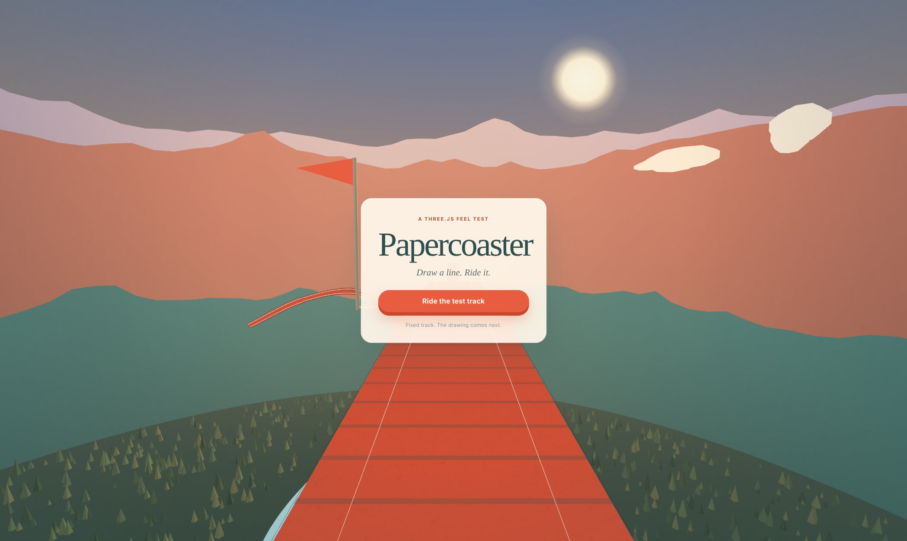
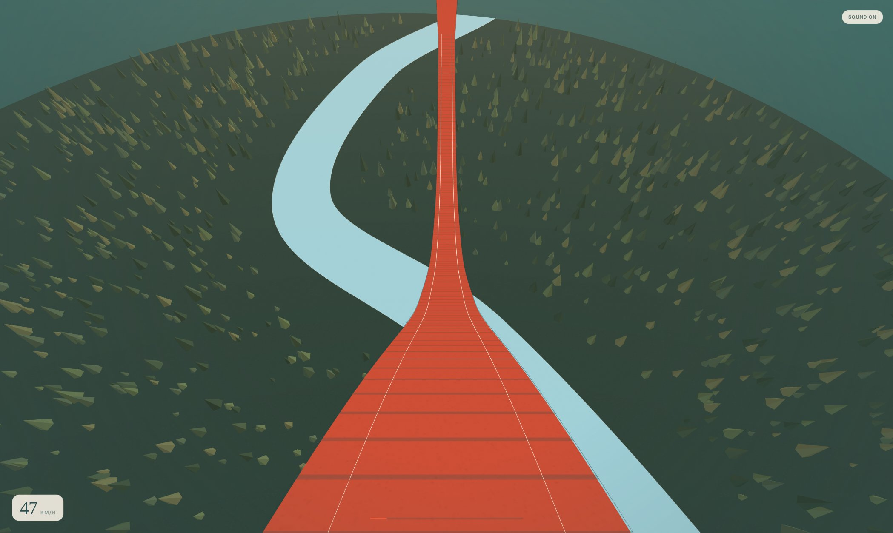

# v0.1.0: feel test

The first playable. A fixed track with a first drop, a vertical loop, and a banked turn. The camera, paper world, and HUD are in place.

**Live demo:** https://jimmerioles.github.io/papercoaster/

## What is in it

- A POV ride with speed-based FOV, look-ahead, and track banking.
- A paper diorama with layered mountain rings, a winding river, a paper forest, clouds, a sun, and a start flag.
- Speed HUD, progress bar, procedural wind, comfort view, and debug freezes.
- `?t=0.18` for the drop, `?t=0.48` for the loop, `?t=0.66` for the turn.

## Known rough edges

- The track is fixed. The drawing layer is next.
- Background tabs throttle the ride.
- The title card hides the first drop until the ride starts.

## Next

Draw one line and ride it. The milestone brief is in
[docs/next.md](https://github.com/jimmerioles/papercoaster/blob/main/docs/next.md).
